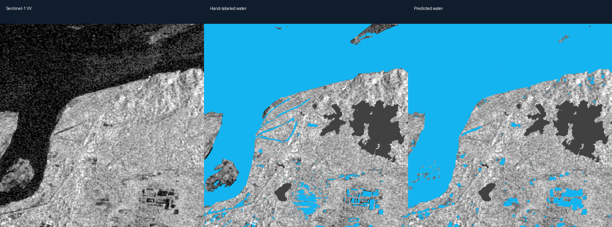

# Flood Detection AI

Train a satellite surface-water segmentation model and export georeferenced masks.
This project uses **real Sentinel-1 radar imagery and human water labels** from
[Sen1Floods11](https://github.com/cloudtostreet/Sen1Floods11).

The trained model is a CPU-friendly histogram gradient boosting classifier, not a
neural network. It classifies each pixel using VV/VH radar backscatter and local
texture. A single scene detects **surface water**, including permanent rivers and
lakes. With an aligned pre-flood scene, the tool reports **candidate newly flooded
pixels** by subtracting previously detected water.

## Setup

Python 3.11 or newer is recommended. Create a virtual environment:

```bash
python -m venv .venv
# Windows PowerShell:
.venv/Scripts/Activate.ps1
# macOS/Linux: source .venv/bin/activate
python -m pip install -r requirements.txt
```

The supplied model's exact training environment is recorded in
`requirements-lock.txt`. Use that file to reproduce the released model environment;
scikit-learn model serialization is version-sensitive. Load only trusted `.joblib`
files because their format can execute Python code.

## Predict

Input must be a two-band Sentinel-1 GeoTIFF: **band 1 VV, band 2 VH in decibels**,
processed consistently with the Sen1Floods11 dataset. JPEGs, optical RGB images,
linear-power radar values and arbitrary band orders are not supported. The program
checks the band count; the caller must verify units and preprocessing.

```bash
python flood.py path/to/sentinel1.tif --output outputs/water.tif
python flood.py path/to/after.tif --before path/to/before.tif --output outputs/candidate_flood.tif
```

Outputs preserve CRS, pixel grid and extent. Values: **0 = other, 1 = water**
(or candidate new flooding with `--before`), **255 = invalid/no-data**.
Before/after rasters must have identical CRS, extent and pixel alignment, and should
use the same orbit and preprocessing. The model processes a scene in memory; tile
large scenes with at least a 3-pixel context halo before inference.

## Reproduce training

```bash
python train.py
python -m unittest -v
```

The default run downloads 96 training, 24 validation and 48 test image/label pairs
from the public dataset bucket into `data/` (several hundred MB). It samples up to
2,000 valid training pixels per image, with seed 42. Images are selected by cycling
through events within each official split after deterministic shuffling. No image
is shared across the three splits. The 11 features are VV, VH, VV minus VH, and
3x3/7x7 local means and standard deviations for each band. Invalid pixels do not
contribute to local statistics or training labels.

The probability threshold is selected using validation water IoU. Test metrics
use all valid labeled pixels in the held-out test subset, with no test tuning.
They are pooled pixel metrics, not event-averaged scores. Events can occur in
multiple official splits, so these results do not establish performance on unseen
flood events. This subset is **not the full published benchmark**.

To use all available chips in each official split:

```bash
python train.py --train-chips 10000 --valid-chips 10000 --test-chips 10000
```

The counts are capped at the number of available images. Training regenerates the
model and reports. `reports/data_manifest.json` records exact selected filenames
and SHA-256 checksums. `reports/metrics.json` records scores and configuration.

## Results

See [measured metrics](reports/metrics.json) and [model card](MODEL_CARD.md).



## Limitations

This is a research baseline, not a validated emergency warning system. Radar
shadow, smooth dry surfaces, urban areas, vegetation, acquisition differences and
speckle can cause errors. Before/after differencing is a heuristic and is not
separately validated as flood-change detection. Model probabilities are not
calibrated confidence estimates. Confirm results with local information and
independent imagery before making operational decisions.

## Data and attribution

Bonafilia, D., Tellman, B., Anderson, T., and Issenberg, E. (2020).
*Sen1Floods11: A georeferenced dataset to train and test deep learning flood
algorithms for Sentinel-1*. CVPR Workshops, pp. 210–211.
[Paper](https://openaccess.thecvf.com/content_CVPRW_2020/html/w11/Bonafilia_Sen1Floods11_A_Georeferenced_Dataset_to_Train_and_Test_Deep_Learning_CVPRW_2020_paper.html).

Source: `https://storage.googleapis.com/sen1floods11/v1.1/`.
Raw datasets are excluded from this repository. Consult the upstream project for
data licensing and reuse terms; this repository does not relicense its data.
